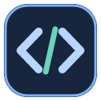
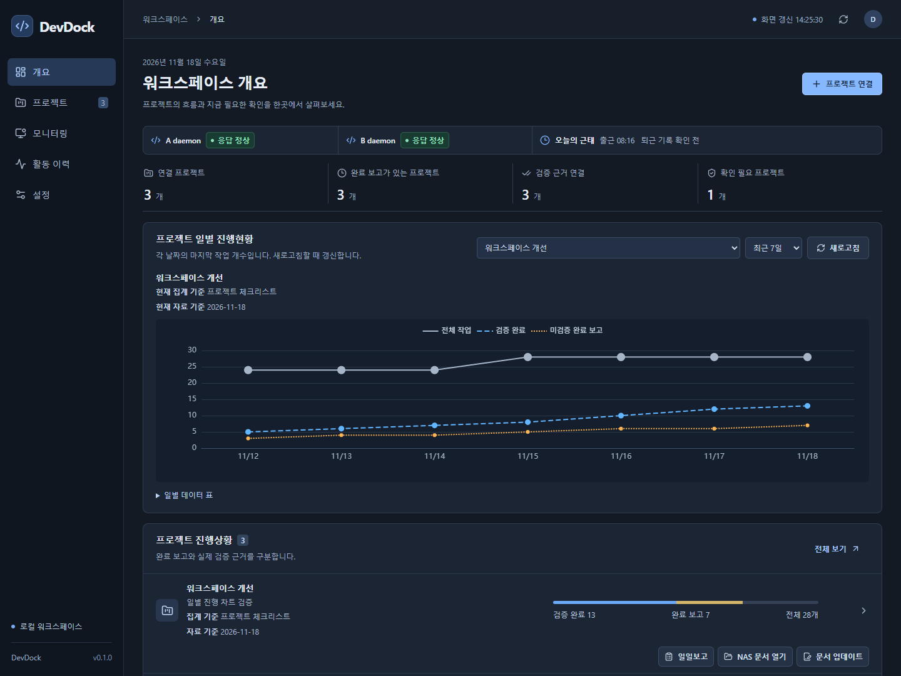

<p align="center">
  
</p>

<h1 align="center">DevDock</h1>

<p align="center">
  <strong>Codex 런타임과 프로젝트 진행을 함께 확인하는 Windows 대시보드</strong><br>
  데몬 상태, 일별 진행 차트, 체크리스트와 업무 문서를 한곳에서 확인합니다.
</p>

<p align="center">
  <a href="#빠른-시작">빠른 시작</a> ·
  <a href="#주요-기능">주요 기능</a> ·
  <a href="#codex와-nas">Codex와 NAS</a> ·
  <a href="CLI.md">CLI 사용법</a> ·
  <a href="https://github.com/nowJDev/DevDock/issues/new">문제 신고</a>
</p>

## 화면 미리보기



<sub>공개용 예시 프로젝트로 실행한 DevDock 화면입니다.</sub>

## 빠른 시작

| 순서 | 화면에서 할 일 |
| --- | --- |
| 1. 실행 | Windows에서 DevDock을 실행합니다. 실행 파일이 필요하면 [소스에서 빌드](#소스에서-빌드)할 수 있습니다. |
| 2. 프로젝트 연결 | **프로젝트 → 프로젝트 연결**에서 프로젝트 폴더를 등록합니다. 진행을 집계할 Markdown 체크리스트가 있으면 함께 지정합니다. |
| 3. 진행 확인 | **개요**에서 프로젝트를 선택해 일별 진행 차트를 열고, **프로젝트**에서 체크리스트·작업 이력·핸드오버를 확인합니다. |

프로젝트의 로컬 문서나 NAS까지 연결하려면 **설정 → 문서 연결 설정**을 엽니다.

## 주요 기능

| 기능 | 확인할 수 있는 것 |
| --- | --- |
| **A/B 데몬 모니터링** | 기존 Codex 데몬의 연결 여부와 관측한 작업 상태를 구분합니다. 5초마다 상태를 다시 확인합니다. |
| **프로젝트 일별 차트** | 전체 항목, 미검증 완료 보고, 검증 완료를 최근 7일·30일 기준으로 봅니다. 문서 이력이 연결된 프로젝트는 진행 기준별로 조회하고 날짜별 원문 근거를 열 수 있습니다. |
| **프로젝트·모니터 관리** | 프로젝트와 파일 기반 모니터를 앱이나 CLI에서 추가·수정·제거합니다. 목록에서 제거해도 기존 프로젝트 파일과 세션은 보존됩니다. |
| **일일보고와 문서 게시** | 선택한 근거로 Codex에 보고를 요청하고, NAS에 반영할 문서와 체크리스트 변경은 미리 검토합니다. |
| **Windows 트레이** | 창을 최소화하거나 닫으면 트레이에 머뭅니다. 좌클릭으로 열고 우클릭 메뉴에서 설정·새로고침·종료를 선택할 수 있습니다. 로그인 시 자동 시작도 설정에서 켤 수 있습니다. |

### 차트 읽는 법

- 체크리스트의 `[ ]`는 미착수, `[-]`는 진행, `[?]`는 결정 필요, `[x]`는 완료 보고입니다. 현재 작업 버전과 일치하는 성공 근거가 연결되면 검증 완료로 집계합니다.
- 차트는 처음 열거나 조회 기준을 바꾸거나 **새로고침**을 눌렀을 때 조회합니다. 데몬과 대시보드 상태는 5초마다 확인합니다.
- 자동 수집은 해당 날짜의 마지막 유효 값을 사용합니다. 근거가 있는 날짜는 **문서 복원**으로 표시하며, 기록이 없는 날은 공백으로 표시합니다. **일별 데이터 표**에서도 같은 값을 확인할 수 있습니다.
- 개발과 실기 수락처럼 집계 기준이 다르면 차트에서 따로 선택합니다. 현재 자료 기준일과 일별 기록일도 각각 표시합니다.

## Codex와 NAS

먼저 **설정 → 문서 연결 설정**에서 공통 핸드오버나 프로젝트별 로컬·NAS 폴더를 등록합니다.

| 프로젝트에서 선택할 버튼 | 처리 흐름 |
| --- | --- |
| **일일보고** | Markdown·텍스트 원문 선택 → 요청 ID를 현재 Codex에 전달 → 초안 편집·검사·복사 또는 로컬 저장. 설치된 `daily-work-report` 스킬을 사용합니다. |
| **NAS 문서 열기** | 연결한 공유 폴더를 Windows 탐색기로 엽니다. |
| **문서 업데이트** | Codex가 제안한 변경을 검토 → 파일과 체크리스트 항목 선택 → 게시 전후 확인 → 게시. NAS 문서 규약 v1.3.0과 기존 게시 완료 영수증이 있는 등록 대상에 적용합니다. |

CLI를 쓰는 Codex는 [CLI 사용법](CLI.md)에서 프로젝트 조회, 체크리스트와 검증 근거 관리, 문서 분석 요청, 보고 초안 제출 명령을 확인할 수 있습니다.

<details>
<summary>스마트원 근태 연결</summary>

설정에서 기존 스마트원 실행 스크립트를 지정하고 근태 기능을 켜면, 기본값으로 매일 **08:10 이상 08:30 미만**에 자동 출근을 시도하고 **17:30 이후** 퇴근 실행 여부를 하루 한 번 묻습니다. 설정에서 시간대를 변경할 수 있습니다. 결과가 불명확하면 자동으로 다시 전송하지 않습니다. 실제 기록은 스마트원에서 확인하세요.

</details>

<details>
<summary>데이터 저장 위치와 관측 범위</summary>

- 기본 데이터 위치는 `%LOCALAPPDATA%\DevDock`입니다. `DEVDOCK_DATA_DIR`을 사용하면 앱과 CLI에 같은 위치를 지정하세요.
- 데몬 모니터링에는 Codex CLI가 필요합니다. 기본 경로는 A가 `%USERPROFILE%\.codex`, B가 `%USERPROFILE%\.codex-B`입니다. 실행 중인 기존 데몬을 공식 프록시로 조회하며, 세부 활동과 승인 내용은 관측 근거가 있을 때 표시합니다.
- 일별 자동 관측의 기본 보존 기간은 90일입니다. 기존 관측을 장기 보관하려면 프로젝트의 **작업 이력**에서 이전 집계 이력 보관을 사용합니다.
- 개인 설정, 데이터베이스, 로그, 로컬 운영 문서는 소스 관리에서 제외합니다.

</details>

## 소스에서 빌드

Windows에서 Node.js, Rust, C++ 빌드 도구, WebView2를 준비합니다. 저장소 루트에서 실행합니다.

```powershell
npm ci
npm run build:desktop
```

설치 파일은 `src-tauri/target/release/bundle/nsis/`에 생성됩니다. 개발 빌드나 `--safe` 검증 모드에서는 실제 근태 실행과 자동 시작 변경을 차단합니다.

<details>
<summary>개발 실행과 테스트</summary>

```powershell
npm run desktop
npm test
npm run build
cargo test --manifest-path src-tauri/Cargo.toml
```

브라우저 미리보기는 별도 `.devdock-data`를 사용하는 읽기 전용 화면입니다.

```powershell
cargo build --manifest-path src-tauri/Cargo.toml --bin devdock-cli
npm run dev
```

</details>
